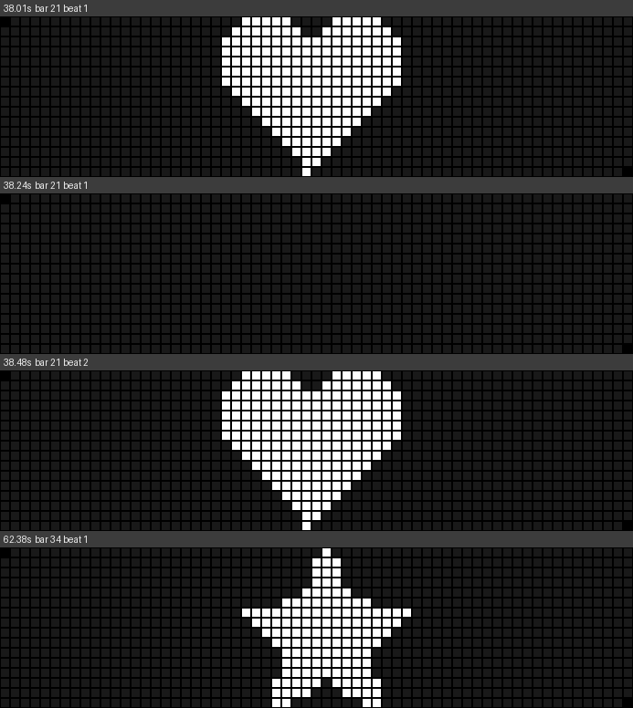

# klightshow-mcp

음악 파일 하나만 주면 AI가 Tesla 라이트쇼 파일 전체를 만들어 주는 MCP 서버입니다. 차 한 대용 쇼도 되고, 주차장 격자(예: 16행 x 63열 = 1,008대) 전체용으로 차마다 다른 `.fseq`를 만들 수도 있습니다.

```
음악 (.mp3/.wav/...)
  → 분석: 템포, 비트, 마디 시작(다운비트), 강한 타격음, 저/중/고음 에너지, 곡 구간(intro/verse/build/drop/break/outro)
  → 자동 안무: 구간마다 에너지에 맞는 템플릿, 비트에 맞춘 점멸, 주차장 파도/체커보드/방사형 패턴, 문 개폐(제한 횟수 안에서)
  → 렌더: 차마다 48채널(또는 200채널) 프레임, 20ms 스텝
  → 내보내기: USB용 폴더 구조 + 44.1kHz 오디오 + 자리 배정표 + ZIP
  → 검증: Tesla validator.py 규칙 + README의 개폐 명령 한도
```

## 설치

필요한 것: Python 3.10 이상, `ffmpeg` (mp3 등을 읽고 44.1kHz로 변환할 때 씀).

```bash
cd klightshow-mcp
python3 -m pip install -e .
# macOS: brew install ffmpeg / Ubuntu: sudo apt install ffmpeg
```

MCP SDK 1.x와 2.x 둘 다 동작합니다.

### Claude Desktop / Claude Code에 연결

`claude_desktop_config.json`:

```json
{
  "mcpServers": {
    "klightshow": {
      "command": "klightshow-mcp",
      "env": { "KLIGHTSHOW_HOME": "/Users/me/klightshow-projects" }
    }
  }
}
```

Claude Code: `claude mcp add klightshow -- klightshow-mcp`

`KLIGHTSHOW_HOME`은 프로젝트와 내보낸 파일이 저장되는 곳입니다 (기본값 `~/klightshow-projects`).

## 쓰는 법

AI에게 이렇게 말하면 됩니다.

> `~/Music/song.mp3`로 16x63 주차장 쇼 만들어줘. 인트로에 "K-LIGHT" 글자 흘려줘.

AI는 `generate_show_from_music` 하나로 분석부터 검증까지 끝내고, 결과 폴더·ZIP·미리보기 GIF 경로를 돌려줍니다. 그 다음 대화로 고칠 수 있습니다.

> 두 번째 드롭은 체커보드 말고 왼쪽에서 오른쪽 파도로 바꿔줘.
> 17마디부터 4마디 동안 방향지시등만 스트로브.
> 사이드미러 접기는 빼줘.

명령줄로 바로 돌릴 수도 있습니다.

```bash
klightshow ~/Music/song.mp3 --rows 16 --cols 63 --title "K-LIGHT" --style energetic
```

### 이미지 넣기

> 이 하트 그림을 두 번째 드롭 첫 마디에 비트마다 깜빡이게 넣어줘. 어떻게 보이는지 먼저 보여줘.

AI는 `place_image(project, image_path, start="bar:21", pulse="beats", dry_run=True)`로 미리보기 그림을 받아 보여주고, 괜찮다고 하면 `dry_run` 없이 다시 넣습니다.

- 차 한 대 = 픽셀 하나. 격자 크기(예: 63x16)에 맞춰 줄이고, 흰 바탕에 검은 그림이면 자동으로 뒤집고, 투명 PNG는 투명한 부분을 꺼진 차로 봅니다. 빈 여백은 잘라냅니다.
- `fit`: `contain`(전체가 보이게, 기본), `cover`(꽉 채우고 넘치는 부분은 자름), `stretch`, `none`(1픽셀 = 1대)
- `scroll`: `left`/`right`/`up`/`down`으로 흘리기, `pulse`: `beats`/`downbeats`/`half_beats`로 박자에 맞춰 깜빡이기
- 이미지가 떠 있는 동안 그 조명 채널은 이미지가 차지합니다(다른 효과는 잠시 가려짐). `target`으로 쓸 조명만 고를 수 있습니다.
- 움직이는 GIF도 됩니다 (`fps`).



## 내보내기 결과

차 한 대 (1x1):
```
export/LightShow/<show>.fseq
export/LightShow/<show>.wav      # 44.1kHz, 파일 이름이 fseq와 같음
```

주차장 격자:
```
export/cars/A01/LightShow/<show>.fseq   # 자리 코드 = 행 문자 + 열 번호
export/cars/A02/LightShow/<show>.fseq
...
export/audio/<show>.wav                 # 모든 차가 같은 오디오
export/assignments.csv                  # 자리, 행, 열, 파일 경로
export/README.txt                       # 차주용 USB 준비 안내
export_<show>.zip
```

`layout="automator"`(명령줄 `--layout automator`)로 내보내면 이 저장소의 K-LightShow USB Automator가 읽는 소스 폴더 구조로 나옵니다: 루트에 `<show>.mp3`, 자리 폴더마다 `<show>.fseq` (`A01/<show>.fseq` ...). 그 폴더를 Automator의 소스 폴더로 고르면 USB에 좌표별로 바로 복사됩니다.

모든 차의 파일은 같은 길이, 같은 0초 시작점입니다. 차마다 다른 건 좌표에 따른 시간 지연(파도 패턴), 차 선택(체커보드 등), 글자/이미지 픽셀뿐입니다. klightshow.pages.dev와 같은 방식입니다.

1,006대 x 100초 쇼를 렌더+검증+ZIP하는 데 약 12초 걸립니다 (`tests/` 기준).

## MCP 도구

| 도구 | 하는 일 |
| --- | --- |
| `generate_show_from_music` | 음악 → 분석 → 자동 안무 → 내보내기 → 검증 → 미리보기 GIF, 한 번에 |
| `analyze_music` | 프로젝트 없이 곡 분석 요약 (BPM, 구간, 비트 수) |
| `create_project` / `list_projects` / `get_project` | 프로젝트 만들기와 조회. 구간에 번호가 붙어 나옴 |
| `get_music_events` | 시간 범위 안의 비트, 다운비트, 타격음 시각과 평균 에너지 |
| `set_grid` | 주차장 행/열, 빈 자리, 행/열 ID |
| `auto_choreograph` | 곡 전체 자동 안무 (손으로 넣은 클립은 유지) |
| `list_clips` / `add_clip` / `update_clip` / `remove_clips` | 타임라인 편집 |
| `reference` | 채널 48개, 그룹, 이펙트, 패턴, 차 선택, 개폐 한도 |
| `preview_car` | 차 한 대의 텍스트 타임라인 |
| `place_image` | 이미지(로고, 하트, 글자 그림, GIF)의 모양을 곡의 원하는 지점에 주차장 전체로 띄우고, 어떻게 보일지 그림으로 돌려줌. `dry_run`이면 미리보기만 |
| `preview_frames` | 원하는 시점들의 주차장 모습을 그림 한 장으로 (시간, 마디·박 표시). AI가 직접 보고 고칠 수 있게 이미지로 반환 |
| `preview_grid` | 주차장 위에서 본 애니메이션 GIF |
| `export_show` | USB용 파일 쓰기 + 검증 |
| `validate_fseq` | 아무 .fseq 검증 (오디오 44.1kHz, 이름 일치 포함) |

시간은 초(`12.5`) 또는 음악 위치로 줄 수 있습니다: `"bar:17"`(17마디 시작), `"beat:64"`, `"section:3"`, `"section_end:3"`.

### 클립

```json
{"start": "bar:17", "end": "bar:21", "effect": "hits", "target": "main_beams",
 "params": {"on": "beats", "hold": 0.15},
 "pattern": {"type": "to_right", "span": 0.47},
 "cars": "checker"}
```

- 이펙트: `on`, `blink`, `strobe`, `hits`(비트/다운비트/반박/타격음에 맞춰 점멸, 그룹 순환 가능), `chase`, `ramp`(Tesla 램프 명령), `breathe`, `follow`(고음/저음 에너지를 따라 켜짐), `twinkle`, `bitmap`(차 한 대 = 픽셀 하나, 글자/PNG/GIF 흘리기), `closure`(open/dance/close/stop)
- 패턴(시간 지연): `to_right`, `to_left`, `to_bottom`, `to_top`, `radial_out`, `radial_in`, `diagonal`, `diagonal_rev`, `snake`, `random`
- 차 선택: `all`, `checker`, `checker_inv`, `odd_rows`, `even_rows`, `odd_cols`, `even_cols`, `left_half`, `right_half`, `top_half`, `bottom_half`, `border`, `center`, `rows`, `cols`, `seats`, `random`
- 조명은 겹치면 더 밝은 값이 이기고, 개폐 채널과 `blend: "override"` 클립은 나중 클립이 덮어씁니다.

### 자동 안무 옵션

- `style`: `balanced`(기본), `energetic`(타격음 스트로브 더 많이), `elegant`(점멸 적게, 숨쉬기 길게)
- `closures`: `none`, `safe`(기본: 사이드미러 접기/펴기, 충전구 열기→무지개 댄스→닫기), `full`(창문 댄스와 리프트게이트도). 차가 빽빽한 행사장에서는 `safe`나 `none`을 권합니다. 팔콘 도어와 앞문은 자동 안무에서 쓰지 않습니다.

## Tesla 규칙 (검증 항목)

- FSEQ v2.0 비압축, 48 또는 200채널, 스텝 15~100ms(20ms 권장), 4시간 미만
- 오디오는 .wav/.mp3, 44.1kHz, fseq와 같은 파일 이름, USB 최상위 `LightShow` 폴더
- 개폐 명령 한도(쇼 하나당): 리프트게이트 6, 미러 각 20, 충전구 3, 창문 각 6, 도어 핸들 각 20, 앞문/팔콘 도어 각 6
- 리프트게이트·충전구·팔콘 도어는 열린 뒤에만 댄스 (리프트게이트는 열리는 데 약 14초)
- 충전구는 연 지 2분이 지나면 자동으로 닫힘
- 개폐 댄스는 쇼당 약 30초 이하 권장, 점멸은 100ms 이상이 보기 좋음

## 한계와 가정

- 비트/구간 분석은 numpy/scipy로 직접 구현했고 4/4박자를 가정합니다. 합성 테스트곡(128BPM)에서 비트 오차 평균 5ms 안쪽, 구간 경계는 마디 단위로 정확했습니다. 실제 곡에서는 아직 검증하지 않았습니다. 박자가 바뀌거나 템포가 크게 흔들리는 곡은 마디 위치가 어긋날 수 있습니다.
- 200채널을 고르면 앞 48채널만 채우고 나머지(사이버트럭 라이트바, 실내 RGB)는 0입니다. 채널 번호 지도는 Tesla xLights 모델 기준입니다.
- 램프 값(10/20/30/70/80/90%)은 xLights 밝기 → 0~255 변환 값의 가운데를 씁니다.
- 실제 현장 동시 시작은 이 도구 밖의 일입니다. 파일들은 같은 0초 기준으로 정렬되어 있을 뿐입니다.

## 테스트

```bash
python3 tests/make_test_song.py /tmp/test_song.wav           # 구간이 뚜렷한 128BPM 합성곡
python3 tests/mcp_smoke.py /tmp/test_song.wav                # MCP stdio로 생성→편집→내보내기→검증
python3 tests/mcp_image_smoke.py <project> heart.jpg star.png /tmp/out   # 이미지 넣기 + 미리보기 그림
```

`examples/`에 16x63 주차장 미리보기 GIF 두 개가 있습니다 (인트로 글자 흘리기, 빌드업→드롭).
